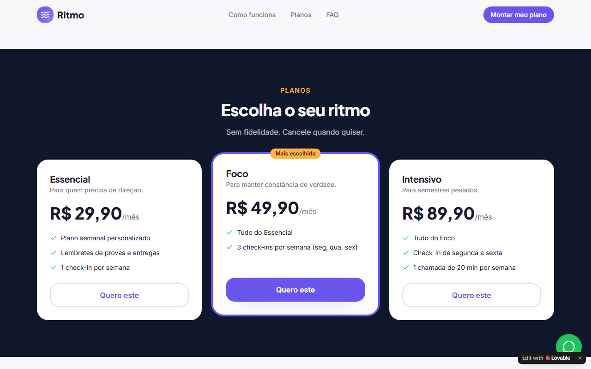
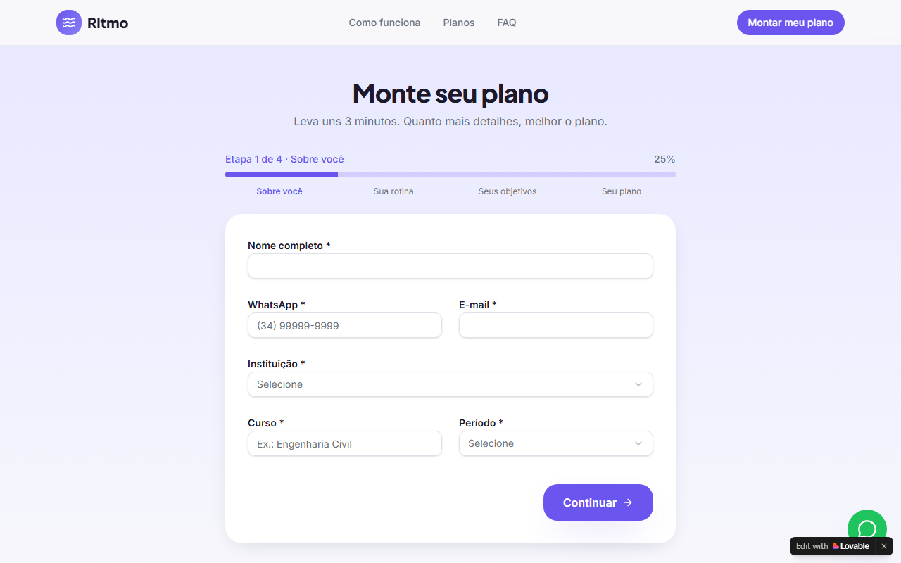
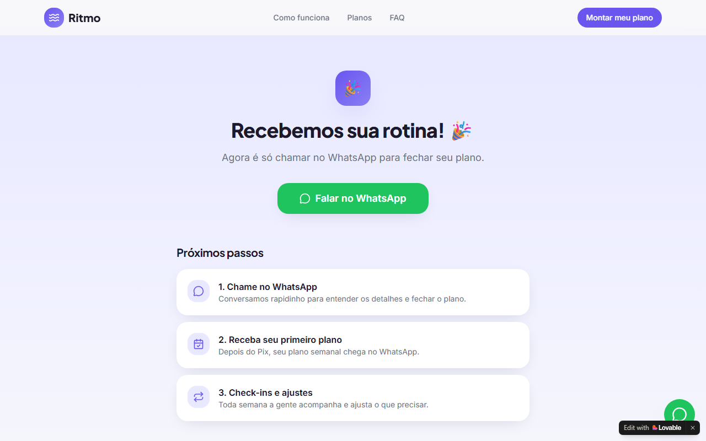
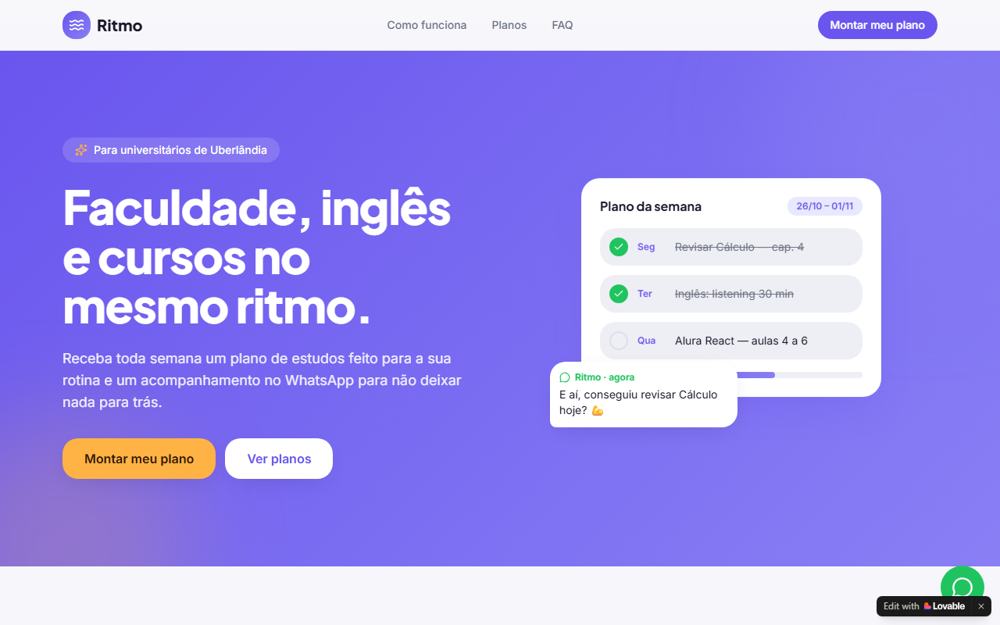
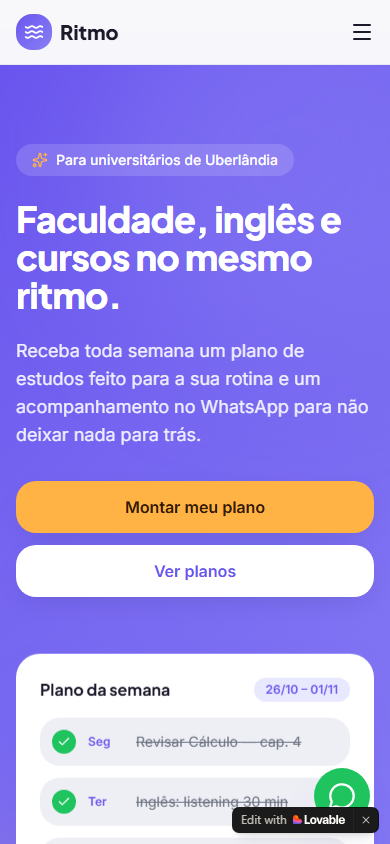
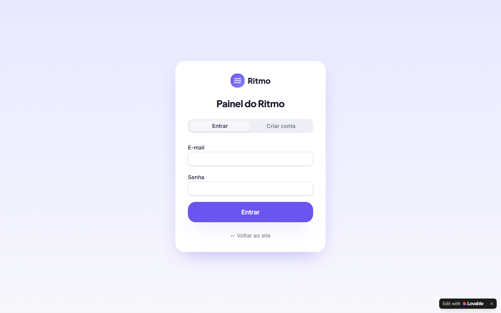

# Ritmo 📚⏱️

> **Faculdade, inglês e cursos no mesmo ritmo.**
> Assinatura de plano de estudos semanal com acompanhamento pelo WhatsApp, para universitários.

🔗 **Aplicação publicada:** [ritmo-estudos.lovable.app](https://ritmo-estudos.lovable.app)

MVP construído do zero no desafio da DIO, usando IA como co-founder para validar a ideia e o **Lovable** (com **Lovable Cloud**) para construir o produto.

---

## 1. A dor escolhida

Curso **Ciência da Computação** e, ao mesmo tempo, faço **curso de inglês** e **cursos complementares** online. Na prática:

- matérias da faculdade acumulam perto das provas;
- prazos de trabalhos e listas são esquecidos;
- o curso de inglês vira "só a aula da semana", sem prática;
- os cursos extras ficam parados na aula 3.

O problema não é falta de vontade, é **falta de um plano realista e de alguém cobrando constância**. Apps de tarefas e agendas ajudam a anotar, mas não montam o plano nem cobram. Mentorias de estudo existem, mas costumam ser caras e voltadas a concursos.

### Por que vale um negócio
| Critério | Avaliação |
|---|---|
| Frequência | Semanal, durante todo o semestre |
| Intensidade | Afeta notas, reprovações e dinheiro investido em cursos |
| Disposição a pagar | Moderada: ticket baixo (a partir de R$ 29,90) e valor claro |
| Operação | Dá para começar com 1 pessoa, sem estoque, sem equipe |
| Acesso aos clientes | Colegas de faculdade, grupos de turma e atléticas em Uberlândia |

### Ideias comparadas
| # | Ideia | Nota (máx. 25) |
|---|---|---|
| **1** | **Assinatura de plano de estudos + acompanhamento** | **22** ✅ |
| 2 | Monitoria com veteranos | 19 |
| 3 | Conversação em inglês para quem é de TI | 16 |
| 4 | Simulado de entrevista de estágio | 16 |
| 5 | Trilha personalizada de cursos complementares | 15 |

Critérios: frequência, intensidade, disposição a pagar, viabilidade de operar sozinho e acesso aos primeiros clientes. A ideia 1 venceu principalmente por ser possível de entregar sozinho desde o primeiro dia.

---

## 2. Tamanho de mercado

Premissa de ticket médio: **R$ 45/mês (R$ 540/ano)**, mistura dos planos Essencial (R$ 29,90), Foco (R$ 49,90) e Intensivo (R$ 89,90) com margem para descontos e cancelamentos.

| | Recorte | Conta | Valor/ano |
|---|---|---|---|
| **TAM** | Todos os universitários de graduação do Brasil | 9.976.782 matrículas (Censo INEP 2023) × R$ 540 | **≈ R$ 5,4 bilhões** |
| **SAM** | Universitários de Uberlândia-MG que conciliam faculdade com outro curso ou trabalho e têm dificuldade de organização | ~50 mil universitários na cidade* × 30%** = ~15 mil × R$ 540 | **≈ R$ 8,1 milhões** |
| **SOM** | O que 1 pessoa consegue atender em 12 meses | 50 assinantes (0,33% do SAM) × R$ 540 | **≈ R$ 27 mil (≈ R$ 2,25 mil/mês)** |

\* Estimativa: UFU (~20 mil alunos de graduação) somada às faculdades privadas e polos EaD da cidade. Premissa a refinar com os microdados do INEP.
\*\* Premissa a validar: parcela dos universitários que conciliam mais de uma frente de estudo/trabalho e relatam dificuldade de organização.

**Limite operacional do SOM:** ~20 min por assinante por semana × 50 assinantes ≈ 17 h/semana, compatível com quem ainda estuda. Acima disso, será preciso automatizar ou contratar.

---

## 3. Business Model Canvas

| Bloco | Descrição |
|---|---|
| **Segmentos de clientes** | Universitários (18 a 26 anos) de Uberlândia que conciliam faculdade com idiomas, cursos online, estágio ou trabalho. Primeiro nicho: cursos de exatas e tecnologia da UFU. |
| **Proposta de valor** | Um plano de estudos semanal feito para a sua rotina real + alguém que acompanha pelo WhatsApp. Mais humano que um app e mais barato que uma mentoria. |
| **Canais** | Landing page, grupos de WhatsApp de turmas, Instagram, atléticas e centros acadêmicos, indicação entre colegas. |
| **Relacionamento** | Pessoal e próximo pelo WhatsApp: check-ins, ajuste semanal do plano, lembretes de provas. |
| **Fontes de receita** | Assinatura mensal: Essencial R$ 29,90, Foco R$ 49,90, Intensivo R$ 89,90. Pagamento por Pix. |
| **Recursos-chave** | Fundador (tempo e experiência com a rotina), WhatsApp, aplicação (landing + painel), modelos de plano de estudos. |
| **Atividades-chave** | Captar leads, fechar vendas no WhatsApp, montar planos semanais, fazer check-ins, acompanhar provas. |
| **Parcerias-chave** | Atléticas e centros acadêmicos, escolas de idiomas, criadores de conteúdo universitário de Uberlândia. |
| **Estrutura de custos** | Plano do Lovable, domínio (opcional), WhatsApp Business (gratuito), tempo do fundador, pequenos anúncios no Instagram. |

---

## 4. Tese e hipóteses

### Tese
> **Universitários pagam uma assinatura mensal para ter um plano de estudos semanal e alguém que os acompanhe.**

### Hipóteses que o MVP testa
| # | Hipótese | Como o MVP testa | Métrica de sucesso |
|---|---|---|---|
| H1 | Universitários reconhecem a dor | Divulgação da landing em 5 grupos de turma | ≥ 30 formulários em 3 semanas (≥ 10% das visitas) |
| H2 | Eles pagam (a tese) | Fechamento pelo WhatsApp com link Pix | ≥ 5 assinaturas pagas (≥ 15% dos leads) |
| H3 | O serviço gera valor contínuo | Renovação no 2º mês | ≥ 60% de renovação |
| H4 | O preço do plano Foco é o ponto ideal | Plano escolhido no formulário e na venda | ≥ 50% escolhem o Foco |
| H5 | A operação manual é viável | Tempo gasto por assinante (registrado nas entregas) | ≤ 20 min por assinante por semana |

### O que ficou manual de propósito
| Manual | Por quê |
|---|---|
| Fechar a venda pelo WhatsApp | A conversa revela objeções e o que o aluno valoriza, que é o aprendizado principal do MVP |
| Enviar o link de pagamento (Pix) à mão | Integrar pagamento antes de provar que as pessoas pagam é desperdício |
| Montar o plano de estudos semanal | Preciso entender o que funciona antes de automatizar ou usar IA |
| Enviar os check-ins pelo WhatsApp | O contato humano é parte da proposta de valor a testar |
| Registrar os pagamentos no painel | Volume baixo no início, não compensa automatizar |
| Sem área logada do aluno | O aluno já vive no WhatsApp; um app novo seria atrito |

---

## 5. Como construí (IA como co-founder)

1. **Escolha da dor:** comparei 5 ideias da minha rotina com uma matriz de notas.
2. **Validação:** estimei TAM/SAM/SOM, montei o Canvas e defini a tese e as hipóteses.
3. **Mega prompt:** escrevi e revisei o prompt inteiro **antes** de colar no Lovable, para economizar créditos.
4. **Construção:** Lovable + Lovable Cloud (banco, autenticação e RLS, sem banco próprio).
5. **Testes e correções:** usei a aplicação como cliente e como admin ([plano de testes](docs/plano-de-testes.md)), juntei os problemas num único prompt e usei o **modo Plan** antes de aplicar.
6. **Publicação:** revisão de segurança do Lovable, publicação e exportação para o GitHub.

### Mega prompt
O prompt completo usado no Lovable está em **[docs/mega-prompt.md](docs/mega-prompt.md)**. Ele cobre:
- fluxo do cliente: landing → formulário em 4 etapas → página de sucesso → WhatsApp com o resumo do plano;
- painel admin: dashboard, leads (com conversão em assinante), assinantes, entregas (agenda semanal gerada por plano) e lembretes;
- banco e segurança: tabelas, papéis de admin em tabela separada e RLS (o público só pode inserir lead);
- identidade visual: cores, fontes e estilo.

### Correções pedidas depois
O prompt único de correção está em **[docs/correcoes.md](docs/correcoes.md)**.

1. **Implementação completa do painel admin:** construção das telas de Dashboard com indicadores e gráfico, gestão de Leads com busca e filtros, Assinantes com CRUD e status de mensalidade, Entregas com geração automática de agenda semanal, e Lembretes com abas (hoje, próximos, atrasados e concluídos).
2. **Fluxo de conversão Lead → Assinante:** modal dinâmico que pré-carrega os dados do lead, vincula o ID e atualiza o status automaticamente para convertido sem duplicidade.
3. **Agenda semanal automática:** rotina de geração de tarefas e check-ins conforme o plano de cada assinante (Essencial, Foco ou Intensivo) com link direto para conversa no WhatsApp.
4. **Documentação completa de negócio e testes:** inclusão do Business Model Canvas, estimativas de mercado para Uberlândia-MG, plano de testes com 27 cenários e especificações do mega prompt.

---

## 6. Telas

| Landing | Planos |
|---|---|
|  |  |

| Formulário | Sucesso |
|---|---|
|  |  |

| WhatsApp com o resumo | Mobile |
|---|---|
|  |  |

### Painel de administração
| Dashboard | Leads |
|---|---|
|  |  |

| Assinantes | Entregas |
|---|---|
|  |  |

---

## 7. Stack
- **Lovable** (geração e hospedagem)
- **Lovable Cloud** (banco de dados, autenticação e RLS)
- React + Vite + TypeScript + Tailwind CSS + shadcn/ui

## 8. Segurança
- Revisão de segurança do Lovable executada antes de publicar.
- RLS em todas as tabelas: visitantes só **inserem** leads; leitura e edição são exclusivas do admin.
- Papel de admin em tabela separada (`user_roles`), verificado no servidor.
- **Nenhuma chave secreta versionada.** O `.env` contém apenas a URL e a chave *publishable* do Lovable Cloud, que são públicas por design e protegidas pelas políticas RLS.

## 9. Próximos passos
- [ ] Alerta de novo lead por e-mail com Resend (chave nos *Secrets* do Lovable Cloud)
- [ ] Gerar o plano semanal com ajuda de IA, a partir das respostas do formulário
- [ ] Pagamento recorrente com Stripe (só depois de validar a tese)
- [ ] Chatbot de check-in no WhatsApp com n8n
- [ ] Manual da marca em PDF

---

Feito em Uberlândia-MG por um estudante de Ciência da Computação que vive essa rotina. 🚀
